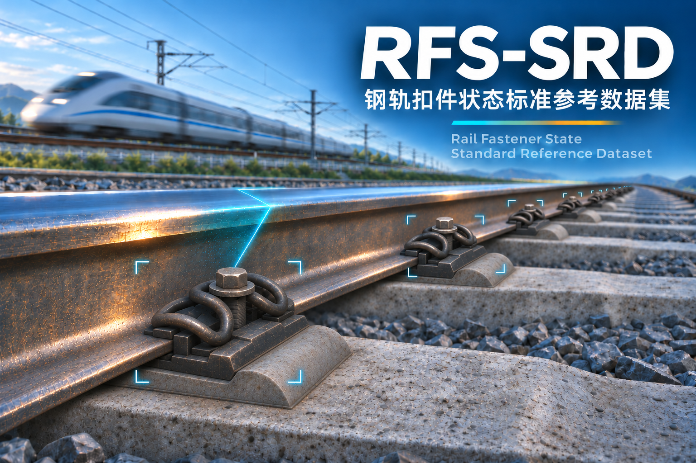

⭐ If you find this project useful, please consider giving it a star!

<h1 align="center">RFS-SRD</h1>

<p align="center">
  <strong>Rail Fastener State Standard Reference Dataset</strong><br>
  Full-scene railway inspection · Six fastener states · Reproducible detector evaluation
</p>

<p align="center">
  
</p>

<p align="center">
  <a href="https://doi.org/10.57760/sciencedb.35426"></a>
  <a href="LICENSE"></a>
  <a href="#benchmark"></a>
  <a href="https://github.com/NIM-NMDC/RFS-SRD/stargazers"></a>
</p>

<p align="center">
  <a href="https://doi.org/10.57760/sciencedb.35426"><strong>Download dataset</strong></a>
  &nbsp; · &nbsp;
  <a href="#quick-start"><strong>Run the benchmark</strong></a>
  &nbsp; · &nbsp;
  <a href="#benchmark"><strong>View results</strong></a>
  &nbsp; · &nbsp;
  <a href="benchmark/README.md"><strong>Detailed guide</strong></a>
</p>

---

<a id="overview"></a>

## 📊 Dataset at a glance

RFS-SRD supports rail-fastener state detection through standardized sample review, verified annotations, and a shared algorithm-evaluation protocol. The images combine real inspection backgrounds and normal fasteners with synthesized damage instances.

| Full-scene images | Annotated instances | Fastener states | Image resolution |
|:---:|:---:|:---:|:---:|
| **500** | **3,000** | **6** | **2048 × 2048** |

| Feature | Release details |
|---|---|
| Scene composition | One damaged fastener and five normal fasteners per image |
| Damage coverage | Missing, Inverted, Displaced, Deformed, and Fractured; 100 images each |
| Normal instances | 2,500 real normal fasteners |
| Annotations | YOLO bounding boxes with verified class IDs |
| Template metadata | 250 damage templates; two images per template |
| Benchmark | Six detectors, five folds, and three training seeds |

<a id="download"></a>

## 📥 Data access

**[Download RFS-SRD from ScienceDB →](https://doi.org/10.57760/sciencedb.35426)**

Persistent identifier: **10.57760/sciencedb.35426**

Dataset images and bounding-box annotations are hosted on ScienceDB. This repository provides the experiment code, fixed split manifests, environment records, and reference metrics. Model checkpoints and plotting scripts are not included.

<a id="classes"></a>

## 🏷️ Fastener states and class IDs

Use the class order below, which matches `classes.txt` in the current dataset release.

| ID | State | Instances |
|---:|---|---:|
| 0 | Normal | 2500 |
| 1 | Deformed | 100 |
| 2 | Inverted | 100 |
| 3 | Fractured | 100 |
| 4 | Missing | 100 |
| 5 | Displaced | 100 |

---

<a id="benchmark"></a>

## 🏆 Internal fivefold benchmark

All six detectors use COCO initialization and 640 × 640 inputs. Each fold contains 300 training, 100 validation, and 100 held-out test images. Results are averaged over five folds and three seeds; F1 SD is calculated across seed-level means. **Bold** marks the best mean in each column.

| Model | F1 ± SD ↑ | AP50 ↑ | AP50–95 ↑ |
|---|---:|---:|---:|
| Faster R-CNN | 0.818 ± 0.005 | 0.845 | 0.743 |
| RetinaNet | 0.689 ± 0.009 | 0.721 | 0.662 |
| FCOS | 0.701 ± 0.079 | 0.752 | 0.682 |
| RT-DETR-L | 0.728 ± 0.273 | 0.754 | 0.708 |
| YOLO11m | **0.951 ± 0.012** | 0.961 | 0.934 |
| YOLOv10m | 0.942 ± 0.008 | **0.963** | **0.935** |

<details>
<summary><strong>Expand all metrics: Precision, Recall, F1, AP, miss rate, false alarms, and FPPI</strong></summary>

| Model | Precision | Recall | F1 ± SD | AP50 | AP50-95 | Miss rate | False-alarm proportion | FPPI |
|---|---:|---:|---:|---:|---:|---:|---:|---:|
| Faster R-CNN | 0.843 | 0.808 | 0.818 ± 0.005 | 0.845 | 0.743 | 0.192 | 0.157 | 0.363 |
| RetinaNet | 0.714 | 0.686 | 0.689 ± 0.009 | 0.721 | 0.662 | 0.314 | 0.286 | 0.546 |
| FCOS | 0.725 | 0.721 | 0.701 ± 0.079 | 0.752 | 0.682 | 0.279 | 0.275 | 0.611 |
| RT-DETR-L | 0.716 | 0.760 | 0.728 ± 0.273 | 0.754 | 0.708 | 0.240 | 0.214 | 1.313 |
| YOLO11m | 0.953 | 0.955 | 0.951 ± 0.012 | 0.961 | 0.934 | 0.045 | 0.047 | 0.079 |
| YOLOv10m | 0.941 | 0.947 | 0.942 ± 0.008 | 0.963 | 0.935 | 0.053 | 0.059 | 0.095 |

</details>

The machine-readable [reference_results/](benchmark/reference_results/) directory contains fold-, seed-, and class-level metrics, operating thresholds, and evaluation metadata. New evaluations are written to `artifacts/cv/results/`.

This release reproduces the internal cross-validation experiment. External real-world training/evaluation is a separate experiment and is not implemented in this code release.

<details>
<summary><strong>Evaluation protocol and metric definitions</strong></summary>

- Five template-group-disjoint folds: 300 training, 100 validation, and 100 test images per fold, with 60/20/20 images from each damage category. Adjacent pairs within a category share a template and remain together. Every image is tested once per seed. Background-source provenance limits are recorded in [split_audit.json](benchmark/manifests/split_audit.json).
- Seeds: `20261112`, `20261113`, and `20261114`. Input dimensions: 640 x 640.
- Torchvision detectors: 30 epochs, batch size 8. YOLO/RT-DETR: up to 100 epochs, patience 20; batch size 16 for YOLO and 8 for RT-DETR. These are the reported architecture-specific training settings.
- Checkpoint selection uses validation data. A separate confidence threshold for each model/fold/seed maximizes validation macro-F1 over 0.01 to 0.99; ties favor the higher threshold.
- Precision, Recall, and F1 use class-aware, score-ordered one-to-one matching at IoU 0.50. AP uses 101-point interpolation; AP50-95 averages IoU 0.50:0.05:0.95.
- Miss rate is FN/(TP+FN). False-alarm proportion is FP/(TP+FP), not FP/(FP+TN). FPPI is total false positives across classes per image. A class with no predictions receives zero precision; its undefined false-alarm proportion is excluded from that metric's class-macro average.
- Class-macro metrics are averaged over five folds per seed, then over three seeds. F1 SD is the sample standard deviation of the three seed-level means. FPPI uses all classes jointly.

</details>

---

<a id="quick-start"></a>

## 🚀 Run the benchmark

Clone this repository, download the dataset from ScienceDB, and follow the commands below from the repository root.

```bash
git clone https://github.com/NIM-NMDC/RFS-SRD.git
cd RFS-SRD
```

### 1. Set up the environment

The reported experiment used Linux, Python 3.9.23, PyTorch 2.1.0, Torchvision 0.16.0, CUDA 12.1, Ultralytics 8.4.51, NumPy 1.26.4, and Pillow 11.3.0. Training requires a CUDA GPU. Exact environment and COCO initialization-weight checksums are recorded in [training_environment.json](benchmark/manifests/training_environment.json).

Example installation for the recorded CUDA environment:

```bash
python3.9 -m venv .venv
source .venv/bin/activate
python -m pip install --upgrade pip
python -m pip install torch==2.1.0 torchvision==0.16.0 --index-url https://download.pytorch.org/whl/cu121
python -m pip install -r benchmark/requirements.txt
```

### 2. Prepare the fixed folds

Extract the ScienceDB archive outside this Git checkout. Preserve its filenames and structure:

```text
/path/to/data/RFS-SRD/
  images/
  labels/
  classes.txt
  notes.json
  metadata/
    image_manifest.csv
    template_groups.csv
```

Run the following commands from the repository root:

```bash
export CUBLAS_WORKSPACE_CONFIG=:4096:8
export OMP_NUM_THREADS=4
python benchmark/prepare_cv.py --dataset /path/to/data/RFS-SRD --output artifacts/cv
```

Preparation creates an experiment-local dataset symlink and materializes the fixed split manifests. Linux is recommended for this workflow.

### 3. Train and evaluate

Run all six architectures, five folds, and three seeds (90 training tasks):

```bash
python benchmark/run_cv.py --root artifacts/cv --gpus 0
python benchmark/evaluate_cv.py --root artifacts/cv --workers 4
```

For multiple GPUs, provide physical IDs, for example `--gpus 0,1,2,3,4,5,7`. The launcher skips completed tasks. `--models yolo11m,yolov10m` and `--seeds 20261112` select a training subset; the aggregate evaluator requires the complete 90-task experiment.

Run one training task:

```bash
python benchmark/train_cv.py --root artifacts/cv --model yolo11m --fold 0 --seed 20261112 --device 0
```

| Model | CLI identifier | Implementation |
|---|---|---|
| Faster R-CNN | `fasterrcnn_r50_fpn_v2` | Torchvision ResNet-50 FPN V2 |
| RetinaNet | `retinanet_r50_fpn_v2` | Torchvision ResNet-50 FPN V2 |
| FCOS | `fcos_r50_fpn` | Torchvision ResNet-50 FPN |
| RT-DETR-L | `rtdetr_l` | Ultralytics |
| YOLO11m | `yolo11m` | Ultralytics |
| YOLOv10m | `yolov10m` | Ultralytics |

All models use generic COCO initialization. Ultralytics resolves `yolo11m.pt`, `yolov10m.pt`, and `rtdetr-l.pt`; use `--pretrained-dir /path/to/coco_weights` to supply local files. Torchvision uses its official pretrained-weight cache/download mechanism. Training saves the selected checkpoint and validation/test predictions under `artifacts/cv/runs/<model>/fold_<fold>_seed_<seed>/`.

### 4. Run checkpoint-based inference

Regenerate predictions for the fixed validation or held-out test subset:

```bash
python benchmark/predict_cv.py --root artifacts/cv --model yolo11m --fold 0 --seed 20261112 --split val --device 0
python benchmark/predict_cv.py --root artifacts/cv --model yolo11m --fold 0 --seed 20261112 --split test --device 0
python benchmark/evaluate_cv.py --root artifacts/cv --workers 4
```

Use `--checkpoint /path/to/checkpoint.pt` for a compatible checkpoint in another location. The checkpoint must use the class IDs above. Inference exports original-image `xyxy` coordinates and low-confidence candidates for AP; the evaluator applies the validation-selected threshold for operating metrics.

## 📂 Repository layout

```text
RFS-SRD/
  README.md
  LICENSE
  CHANGELOG.md
  classes.txt
  assets/
    RFS-SRD-cover.png
  benchmark/
    README.md
    requirements.txt
    prepare_cv.py
    train_cv.py
    run_cv.py
    predict_cv.py
    model_loader.py
    evaluate_cv.py
    metrics.py
    manifests/
    reference_results/
```

The dataset archive also includes `benchmark/`. Both copies implement the same experiment; choose one code location when running commands.

## 📜 License and citation

Project code is distributed under the [MIT license](LICENSE). Third-party frameworks and pretrained weights retain their own licenses. Dataset access and reuse conditions are specified in the ScienceDB record. When using the data, cite [DOI: 10.57760/sciencedb.35426](https://doi.org/10.57760/sciencedb.35426).

---

<p align="center">If RFS-SRD supports your research, please cite the dataset and consider starring this repository.</p>
